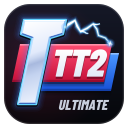
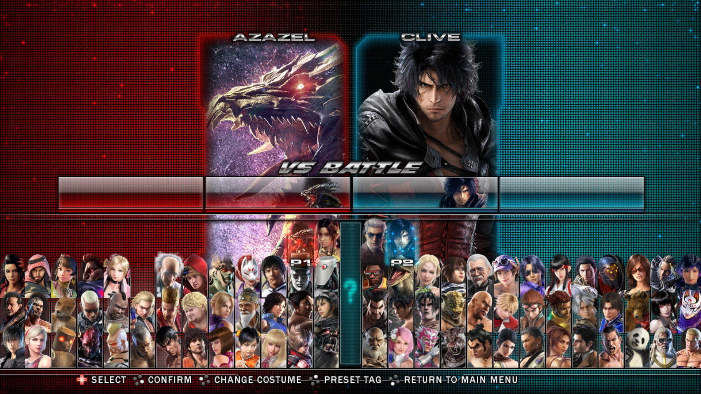
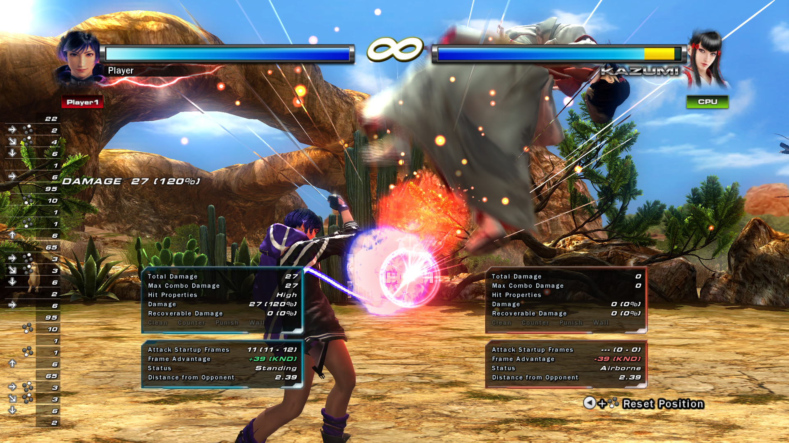
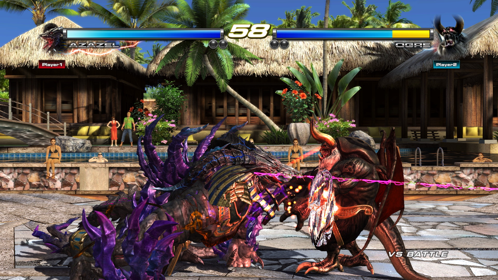
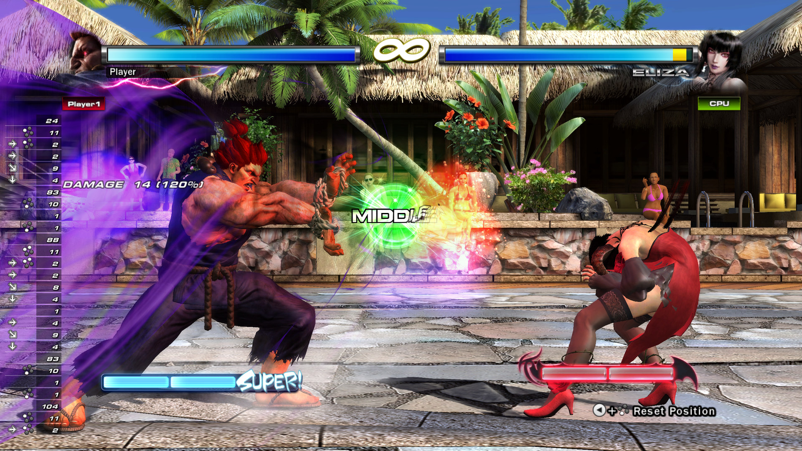

  

<h1 align="center">Golden Fist Launcher</h1>

  <b>Tekken Tag Tournament 2 Wii U Edition as a native PC game, with the fighters of Tekken 7 and Tekken 8.</b>

  
  
  

  <a href="#download">Download</a> ·
  <a href="#quick-start">Quick start</a> ·
  <a href="#features">Features</a> ·
  <a href="#documentation">Documentation</a>

Golden Fist Launcher (called Ultimate Launcher up to 0.8.0) builds, installs, updates and starts an unofficial native
PC port of **Tekken Tag Tournament 2 Wii U Edition**, made from **your own copy** of the game, on Linux and Windows.
It also adds the fighters of **Tekken 7** and **Tekken 8** to the roster, made from your own Steam games.

The port is not an emulator: the game's code is translated to C++ ahead of time and runs as a native program, with
its graphics on Vulkan, at up to 120 frames per second and 5K ([how it works](docs/HOW_IT_WORKS.md)).

> [!IMPORTANT]
> **No game files are included.** This repository holds only original tools
> and runtime code; you need your own copy of the game
> ([see below](#what-you-need)). The C++ generated from the game, programs built
> from it, an install folder, character packs, and captures or dumps made with the
> debugging options all contain the game's code or assets: do not share or upload
> them, and do not attach them to issues.
>
> This project is not affiliated with or endorsed by Bandai Namco
> Entertainment or Nintendo. TEKKEN, Tekken Tag Tournament and Wii U are
> trademarks of their respective owners.

## Screenshots

<table>
  <tr>
    <td align="center" width="50%">
      
       Character select with every added fighter
    </td>
    <td align="center" width="50%">
      
       Practice: Reina vs Kazumi with frame data
    </td>
  </tr>
  <tr>
    <td align="center" width="50%">
      
       Azazel vs True Ogre
    </td>
    <td align="center" width="50%">
      
       Practice: Akuma vs Eliza
    </td>
  </tr>
</table>

## Features

### The game, native on your PC

- **No emulation**: the intro, the menus, character select, arcade mode and versus matches, with sound and saves, run
  as native code; the Wii U's system libraries are rewritten for the PC.
- **120 frames per second** on displays of 100 Hz and more, with the game's logic still at 60, and **even frame
  pacing** on 120 Hz and 240 Hz displays.
- **Higher resolutions**: up to 4x the original 720p (5120x2880), chosen for your display by default.
- **No forced input delay**: the two frames the Wii U game waits after each button press are gone (a setting puts
  them back).

### 23 new fighters

- **17 from Tekken 7**: Kazumi, Lucky Chloe, Eliza, Claudio, Akuma, Gigas, Josie, Katarina, Master Raven, Shaheen,
  Fahkumram, Leroy, Lidia, Kunimitsu II, Negan, Geese Howard and Noctis.
- **6 from Tekken 8**: Reina, Azucena, Miary Zo, Victor Chevalier, Clive Rosfield and Azazel (at his full giant
  size).
- Their own models, moves, voices, effects, command lists and subtitles, and a cell of their own on the select
  screen, which grows a new row when it fills up. No fighter is replaced.
- **Made for tag**: tag-outs, tag throws, Tag Assaults and Tag Crashes, and bound moves (Tekken 7's fighters bound as
  in the Tekken 7 Bound Mod).
- **Outfits**: Tekken 7's preset outfits, and CUSTOMIZE for 20 of them: Tekken Tag Tournament 2's shop outfits, fitted
  to their bodies, with colours and PAINT.

### Training like in Tekken 8

- **Frame data** panels in Practice: damage, hit level, startup, frame advantage, counter hits, punishes, distance.
- **Input history**, a **position reset** (3 + Select), fighters coloured by frame advantage.
- **3D hitboxes**, a **view from above** and **slow motion**, in the pause menu's ULTIMATE SETTINGS.

### More to play

- **Solo Ghost Battle**: a new Offline mode, Ghost Battle fought one on one.
- **Local multiplayer**: every keyboard or gamepad that presses Start joins as a player of its own in VS Battle,
  Team Battle and Pair Play, up to five.
- **PAINT without a Wii U GamePad**: with the mouse, a touch screen, or a controller's stick.
- **Seven languages**: English, French, German, Italian, Spanish and Russian, plus Polish, the port's own translation;
  and your own name in place of "Player".

### Controls

- **Keyboard and any gamepad**: keys you choose in the launcher (they change at once, even while the game runs).
- **Buttons as on a computer**: menus confirm with the bottom face button, and the button icons follow your
  controller (PlayStation-style or neutral). Nintendo controllers keep the Wii U's way.

### Golden Fist Launcher

- **One window for everything**: install, play, update, add fighters and change settings, with the keyboard, the mouse
  or a controller.
- **Linux, Windows and the Steam Deck**: an AppImage and a Windows `.exe`, both updating themselves.
- **One button to update**: the launcher, the game program and your added fighters, in one go.

## Download

Get the newest version from the **[latest release](https://github.com/Petexy/Golden-Fist-Launcher/releases/latest)**:

| System | File | How |
| --- | --- | --- |
| Linux | `Golden_Fist_Launcher-x86_64.AppImage` | Make it executable and start it. Needs glibc 2.39 or newer (Ubuntu 24.04, Debian 13, Fedora 40 and newer, rolling distributions). |
| Windows 10/11 (x64) | `Golden_Fist_Launcher-x86_64.exe` | Put it in a folder of your own (not Program Files: it replaces itself when it updates) and double-click it. |
| Steam Deck | `Golden_Fist_Launcher-x86_64.AppImage` | In Desktop Mode, as on Linux. SteamOS can't install packages, so the launcher tells you which tools must come from a toolbox or distrobox container. |

The `.exe` is not code-signed, so Windows Defender may flag a new release by guess. More about each launcher:
[Golden Fist Launcher](docs/LAUNCHER.md).

## What you need

- **Your own Tekken Tag Tournament 2 Wii U Edition**: the European release with update v16, dumped from your
  console as a `.wua` archive (Cemu can create one from an installed title) or as a folder with the game's `code/`,
  `content/` and `meta/`. Other versions have different code and are not supported
  ([how to check yours](docs/PLAYING.md#your-copy-of-the-game)).
- **A PC** with an x86-64-v3 processor (AVX2 and FMA: Intel Haswell, AMD Excavator or newer), a Vulkan 1.3 graphics
  driver, and room for the installed game (16 GB) and its build (on Windows, with the tools, plan about 30 GB).
  - **Linux**: Clang (or GCC 15+) and the SDL 3.2+, shaderc, Vulkan, OpenSSL 3, zstd and zlib libraries, to build
    the game program on your PC. The launcher checks for them and shows the command that installs what's missing.
    (Ubuntu 24.04 has no SDL 3.2 yet.)
  - **Windows**: nothing to install; the first setup downloads the tools it needs.
- **For the added fighters (optional)**: Tekken 7 and/or Tekken 8 for PC on Steam, started once from Steam, with
  Steam running. Only fighters your Steam account owns are added. On Linux, also gamescope and Python 3
  ([details](docs/ADDING_FIGHTERS.md#what-you-need)).

## Quick start

1. Start the launcher you [downloaded](#download).
2. On **Home**, choose **Install** (**Set Up** on Windows), pick your `.wua` and a folder for the game, and confirm.
3. Wait while the launcher checks your PC, builds the game program from your copy and installs it. This takes a few
   minutes; the first Windows setup takes longer.
4. Press **Play**.
5. To add fighters: start Steam, close Tekken 7 and Tekken 8, open **Fighters**, and choose **Add** on a fighter or
   **Add All Owned**.
6. In **Settings**, set your name, the game's language, the resolution, 120 fps and your keys.

When a new version is out, Home's big button becomes **UPDATE**: it brings the launcher, the game program and your
added fighters up to date.

## Status

Playable from boot through arcade mode; arcade mode has been played through by hand. Tested on Linux with an AMD
GPU (RADV) under KDE Plasma (Wayland). Only the European version with update 16 is supported (other versions have
different code).

Not done yet:

- the Wii U GamePad's screen and speaker;
- online play;
- the software keyboard and error viewer screens;
- audio effects the game does not seem to use;
- for the added fighters, Rage Arts, power crush armour and some weapons
  ([the full list](docs/ADDING_FIGHTERS.md#what-they-bring-and-what-is-left-out)).

Found a bug? [Open an issue](https://github.com/Petexy/Golden-Fist-Launcher/issues) and attach the game's log
(`~/.cache/ttt2/game.log` on Linux; on Windows, **More** > **Open Latest Log** on Home), never game files.

## Documentation

| Page | What's in it |
| --- | --- |
| [Playing](docs/PLAYING.md) | Your copy of the game, starting it without the launcher, picture, controls, local multiplayer, settings files, environment variables |
| [Practice](docs/PRACTICE.md) | Frame data panels, ULTIMATE SETTINGS (hitboxes, top camera, slow motion), command history, position reset |
| [Golden Fist Launcher](docs/LAUNCHER.md) | The three screens, what the launcher needs, the AppImage, updates, the Windows launcher, folders and logs |
| [Adding fighters](docs/ADDING_FIGHTERS.md) | Who can join, what you need, the importer, character packs, every fighter's bound moves |
| [Building from source](docs/BUILDING.md) | Requirements, building the game program and the launcher, release programs, tests |
| [How it works](docs/HOW_IT_WORKS.md) | Static recompilation, the source tree, changing the game |
| [Architecture](docs/ARCHITECTURE.md) | The full design notes, measurements and milestones |
| [Azazel from Tekken 8](docs/azazel-tekken8-notes.md) | What porting a giant boss taught |
| [Changelog](CHANGELOG.md) | What changed in each release |
| [Third-party notices](THIRD_PARTY_NOTICES.md) | The works the programs are built with, and their licenses |

## Building from source

Players don't need to: the launcher builds the game program on their PC. To work on the project, fetch the pinned
dependencies with `python3 tools/setup_deps.py` and build with CMake, Ninja and Clang; every step, the release
programs and the tests are in [Building from source](docs/BUILDING.md).

## Changelog

What changed for players in each release is in [CHANGELOG.md](CHANGELOG.md); downloads and checksums are on the
[Releases](https://github.com/Petexy/Golden-Fist-Launcher/releases) page.

## License

This repository's code is under the [MIT License](LICENSE). It does not cover
the game, or anything generated from it.

Fetched by `tools/setup_deps.py`, under their own licenses:
[ZArchive](https://github.com/Exzap/ZArchive) (MIT-0) and AMD's address
library ([decaf-emu/addrlib](https://github.com/decaf-emu/addrlib), MIT,
built into the `ttt2` program). The port also links SDL3 (zlib), shaderc
(Apache-2.0), the Vulkan loader (Apache-2.0), OpenSSL (Apache-2.0), zstd
(BSD) and zlib.

The launcher's new interface is made with SDL 3 (zlib; fetched by
`tools/setup_deps.py --launcher` and built into its release programs),
stb_truetype and stb_image_write (public domain or MIT), nanosvg (zlib) and
the Barlow, Barlow Condensed and JetBrains Mono fonts (SIL Open Font License
1.1), which are in `launcher/ui` with their licenses: see
[THIRD_PARTY_NOTICES.md](THIRD_PARTY_NOTICES.md).

## Acknowledgements

- [Cemu](https://github.com/cemu-project/Cemu) and
  [decaf-emu](https://github.com/decaf-emu/decaf-emu), whose reverse
  engineering of the Wii U's system libraries and GPU documented much of the
  behaviour reimplemented here (structure layouts, register values, formats,
  GX2's surface layout rules). This repository's code is its own.
- [Dolphin](https://github.com/dolphin-emu/dolphin), whose hardware-tested
  PowerPC interpreter is the reference the instruction tests compare
  against, and whose hardware research measured the processor's estimate
  tables.
- [XenonRecomp](https://github.com/hedge-dev/XenonRecomp) and
  [N64Recomp](https://github.com/N64Recomp/N64Recomp), for showing how far
  function-level static recompilation can go.
- [TKMovesets2](https://github.com/Kiloutre/TKMovesets) and
  [TekkenMovesetExtractor](https://github.com/Kiloutre/TekkenMovesetExtractor),
  whose research documented the Tekken 7 and Tekken Tag Tournament 2 moveset layouts, their
  animations and what their requirement and property ids mean, which the
  character importer builds on (its movesets are in TKMovesets2's .tkmvst
  layout, which it can also read); the Tekken 7 Bound Mod, whose choice of
  bound moves the added Tekken 7 fighters have;
  [UE Viewer](https://github.com/gildor2/UEViewer) and
  [CUE4Parse](https://github.com/FabianFG/CUE4Parse), for Tekken 7's Unreal
  Engine 4.14 packages. The importer's code is its own.
- [Excentrian](https://github.com/Excentrian), who designed the title
  screen's "ULTIMATE EDITION" subtitle
  ([#9](https://github.com/Petexy/Golden-Fist-Launcher/issues/9)):
  the port letters it after that design, its M and A from Excentrian's
  outlines.
